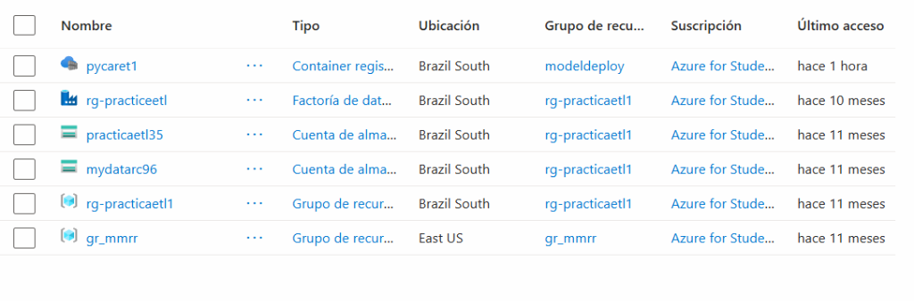
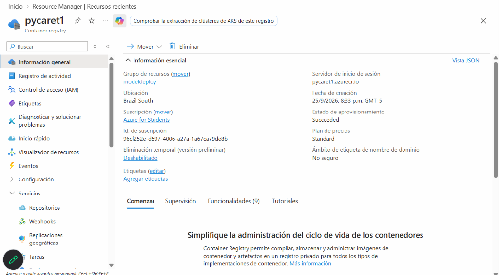
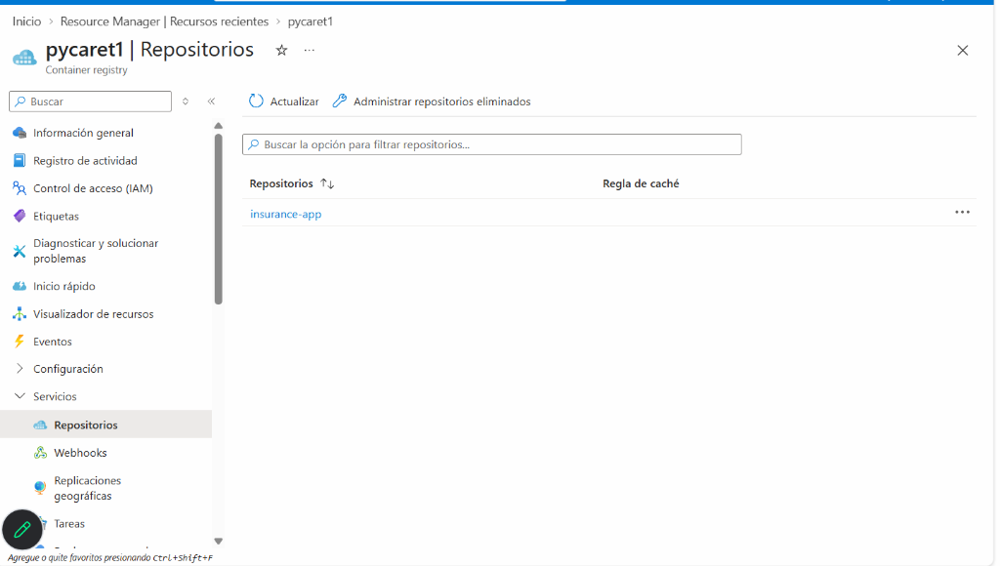
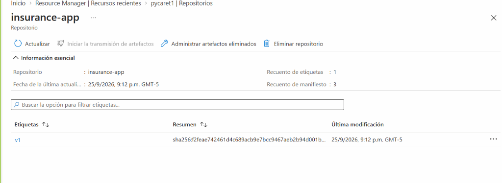
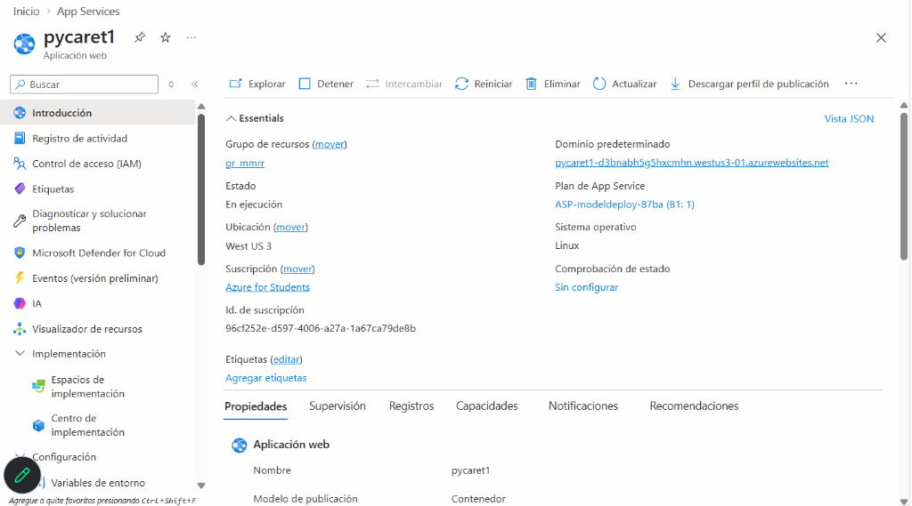
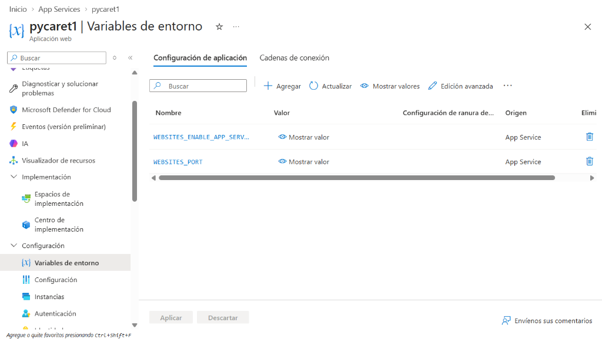

# 📘 Documentación Paso a Paso: Despliegue MLOps en Azure & GitHub Actions

**Fecha:** 2026-10-09  
**Proyecto:** PyCaret Insurance Cost Prediction Web App  
**Repositorio GitHub:** `rafaelchamorro/sample-pycaret`  

---

## 📋 Resumen de Recursos Identificados en Azure

| Recurso Azure | Nombre | Grupo de Recursos | Ubicación | Detalles / SKU |
|---|---|---|---|---|
| **Container Registry (ACR)** | `pycaret1` | `modeldeploy` | Brazil South | `pycaret1.azurecr.io` (Standard) |
| **Repositorio Docker en ACR** | `insurance-app` | - | Brazil South | Imagen con tag `v1` existente |
| **Web App (App Service)** | `pycaret1` | `gr_mmrr` | West US 3 | Linux Container, Plan `ASP-modeldeploy-87ba (B1: 1)` |
| **URL Pública de la App** | `https://pycaret1-d3bnabh5g5hxcmhn.westus3-01.azurewebsites.net` | - | - | Endpoint de salud: `/health` |

---

## 📸 Evidencias de la Plataforma (Capturas de Pantalla)

### Paso 1: Lista de Recursos y Ubicación (Brazil South)
Verificación del Azure Container Registry `pycaret1` desplegado en la región **Brazil South** dentro del Resource Group `modeldeploy`.

---

### Paso 2: Información General del Azure Container Registry (ACR)
Panel principal del registro `pycaret1` con el Servidor de Inicio de Sesión (`pycaret1.azurecr.io`), estado *Succeeded* y nivel *Standard*.

---

### Paso 3: Repositorio Docker `insurance-app` en ACR
Listado de repositorios dentro del ACR `pycaret1`, confirmando la existencia del repositorio `insurance-app`.

---

### Paso 4: Historial de Etiquetas e Imágenes en ACR
Detalle del repositorio `insurance-app` donde se observa el manifiesto de la etiqueta `v1`. El nuevo pipeline de GitHub Actions publicará automáticamente los nuevos tags con el commit SHA y `latest`.

---

### Paso 5: Azure Web App for Containers (`pycaret1`)
Panel de control de la aplicación web en Azure App Service:
- **Nombre:** `pycaret1`
- **Ubicación:** `West US 3`
- **Plan de App Service:** `ASP-modeldeploy-87ba (B1: 1)`
- **Modelo de publicación:** Contenedor Linux
- **Botón clave:** *Descargar perfil de publicación* (Download publish profile) en la barra superior.

---

### Paso 6: Configuración del Puerto en Azure Web App (`WEBSITES_PORT=5000`)
Configuración de la variable de entorno `WEBSITES_PORT` con valor `5000` en **Variables de entorno > Configuración de aplicación**, permitiendo a Azure App Service dirigir las peticiones HTTP directamente al puerto 5000 expuesto por Flask en el contenedor.

---

## 🔐 Configuración Final de Secretos en GitHub Actions

En tu repositorio de GitHub [rafaelchamorro/sample-pycaret](https://github.com/rafaelchamorro/sample-pycaret) (`Settings > Secrets and variables > Actions > New repository secret`), debes configurar:

| Secreto | Valor Exacto para tu Entorno |
|---|---|
| `ACR_LOGIN_SERVER` | `pycaret1.azurecr.io` |
| `ACR_USERNAME` | `pycaret1` *(Debe estar habilitado el usuario admin en ACR > Claves de acceso)* |
| `ACR_PASSWORD` | *(Copia la 'password' de ACR > Claves de acceso)* |
| `AZURE_WEBAPP_NAME` | `pycaret1` |
| `AZURE_WEBAPP_PUBLISH_PROFILE` | *(Contenido íntegro del XML descargado desde el botón 'Descargar perfil de publicación' de la Web App)* |

---

## ⚙️ Configuración del Puerto en la Web App (Crítico)
Para que Azure App Service enrute el tráfico correctamente al contenedor Flask:
1. En la Web App `pycaret1`, navega en el menú lateral a **Configuración** (o **Variables de entorno**).
2. Agrega la variable:
   - **Nombre:** `WEBSITES_PORT`
   - **Valor:** `5000`
3. Haz clic en **Guardar**.
